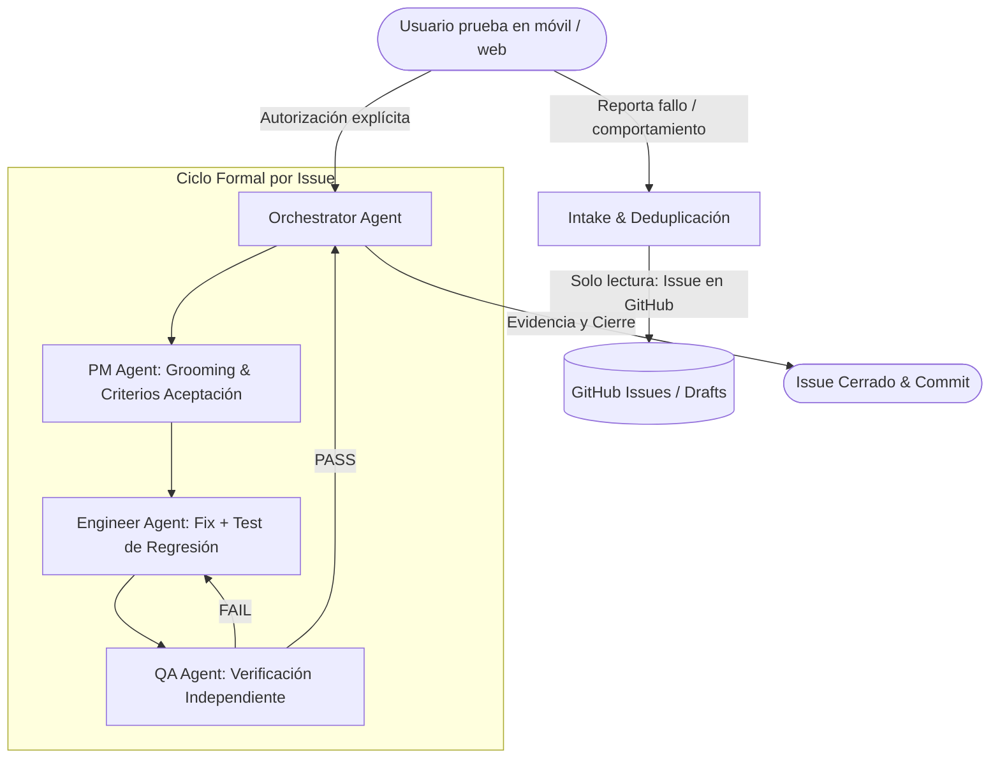

# Proceso de Desarrollo Asistido por Inteligencia Artificial (IA)

Este documento detalla cómo se ha utilizado la Inteligencia Artificial durante la concepción, diseño, implementación y mantenimiento iterativo de **Proyecto AI**, cumpliendo con los estándares de ingeniería de software y control humano (*Human-in-the-Loop*).

---

## 1. Herramientas de IA Utilizadas

| Herramienta / Modelo | Ámbito de Aplicación | Razón de Elección |
| :--- | :--- | :--- |
| **Google Gemini (en Antigravity IDE)** | Orquestación, análisis arquitectónico, planificación (PM), implementación de código (Ingeniero) y diseño de pruebas de aceptación (QA). | Capacidad de contexto amplio para razonar sobre todo el repositorio, comprensión de TypeScript/Python y capacidad agentic. |
| **Web Speech API & Whisper STT** | Transcripción de dictado por voz continuo en tiempo real en frontend (móvil y web). | Precisión en reconocimiento de voz en español y soporte nativo en navegadores modernos. |
| **Modelos LLM para Estructuración Semántica** | Extracción estructurada de entidades (título, categoría, fecha relativa, prioridad, etiquetas) a partir de transcripciones orales en bruto. | Flexibilidad para entender lenguaje coloquial (ej. *"el lunes de la semana que viene con prioridad alta"*). Ver [`_docs/llm_structuring_prompt.md`](./llm_structuring_prompt.md). |

---

## 2. Evolución del Flujo de Trabajo

El flujo de trabajo con IA no fue estático; evolucionó a lo largo del proyecto para maximizar la calidad y evitar regresiones:

### Fase 1: Flujo Inicial para el MVP y primeros Issues
1. **Especificación inicial:** Se redactó la especificación del MVP en [`_docs/spec.md`](./spec.md) y [`_docs/domain-model-v0.1.md`](./domain-model-v0.1.md).
2. **Backlog inicial por tareas:** Se definieron tareas incrementales en [`_docs/tasks.md`](./tasks.md) estructuradas en orden de dependencia (Fundaciones frontend/backend -> SQLite local -> API de sincronización -> UI de calendario y voz).
3. **Generación asistida:** El desarrollador humano definía el objetivo técnico de la tarea, Gemini generaba la propuesta de código y se comprobaba la compilación y los tests básicos.

### Fase 2: Adaptación a un Flujo Riguroso Multi-Rol (PM -> Engineer -> QA)
A medida que la aplicación creció y comenzó a probarse en dispositivos reales (iPhone en Safari y Expo Go), surgieron casos límite (duplicaciones de audio en Safari, parsing de fechas relativas complejas, sincronización de prioridades). Para abordarlos con máxima robustez, se diseñó e implementó un protocolo formal documentado en [`_docs/process.md`](./process.md):

1. **Intake de Solo Lectura:** Cuando el usuario reporta un fallo o adjunta capturas de pantalla, la IA investiga la causa raíz y lo documenta en un issue de GitHub (o borrador local en `_docs/defect-drafts/`), **sin modificar código**.
2. **Aprobación Humana Obligatoria:** Ningún cambio en el código se inicia hasta que el usuario lo solicita explícitamente (ej. *"soluciona los fallos de la recámara"* o *"soluciona el issue de la prioridad"*).
3. **Separación de Contextos y Roles:**
   - **PM (`_docs/team/pm.md`):** Analiza el problema, define criterios de aceptación verificables (Given/When/Then) y marca qué archivos deben intervenirse.
   - **Software Engineer (`_docs/team/software-engineer.md`):** Implementa el cambio mínimo necesario y crea un test automatizado que demuestre la corrección.
   - **QA Engineer (`_docs/team/qa-engineer.md`):** Ejecuta la suite de pruebas completa de forma independiente y valida cada criterio sin editar código.

---

## 3. Ejemplos Representativos de Casos Resueltos con este Flujo

| Issue | Descripción del Problema | Causa Raíz Detectada | Solución y Verificación |
| :--- | :--- | :--- | :--- |
| **#47** | Conflictos en sincronización offline | Entradas editadas en local y remoto simultáneamente generaban inconsistencias. | Implementación de modal de resolución de conflictos en React y test de integración `ConflictResolver.test.tsx`. |
| **#49** | Persistencia y sincronización de categorías y etiquetas | Las etiquetas creadas en cliente requerían sincronización bidireccional idempotente. | Expansión de endpoints en FastAPI y tests `test_sync_api.py` y `syncEngine.test.ts`. |
| **#56** | Filtros combinados en calendario | Filtrar por categoría no actualizaba correctamente los eventos del mes en Expo. | Refactorización de hooks reactivos y validación en `CalendarCategoryFilter.test.tsx`. |
| **#57** | Duplicación de texto en dictado continuo en Safari (iOS) | El evento `onresult` de Safari Web Speech repetía fragmentos intermedios en modo continuo. | Algoritmo de deduplicación de prefijos en `voiceRecognition.ts` + tests unitarios específicos. |
| **#58** | Comprensión de fechas relativas como *"el lunes de la semana que viene"* | El parser regex solo entendía *"mañana"* o *"pasado mañana"*. | Extensión del analizador de lenguaje natural en `voiceParser.ts` con cálculo dinámico de semanas. |
| **#59** | Fallo al extraer contenido con prioridad de tarea | Al dictar *"Tarea fecha mañana tengo que ir al mercado prioridad alta"*, el comando de prioridad truncaba el contenido. | Preservación de buffer completo en `voiceRecognition.ts` y extracción regex robusta en `voiceParser.ts`. |

---

## 4. Control Humano sobre el Código Generado (Human-in-the-Loop)

Para garantizar la estabilidad del software y evitar alucinaciones:
- **Pruebas en dispositivos físicos reales:** Tras cada corrección, el usuario prueba la aplicación en su iPhone personal usando Expo Go o Safari mediante el túnel seguro de Cloudflare (`.\start.ps1`).
- **Regla de Cero Nuevas Dependencias:** La IA tiene estrictamente prohibido añadir dependencias en `package.json` o `pyproject.toml` sin consultar previamente al usuario.
- **Doble barrera de pruebas automatizadas:**
  - Frontend: 158 tests en Jest (`npm run test`).
  - Backend: 104 tests en Pytest (`pytest`).
  - Todo cambio debe mantener el 100% de los tests pasando antes de realizar commit.

---

## 5. Prompts y Estructuración Semántica

Los prompts utilizados para instruir a los modelos y para la extracción semántica de voz se encuentran versionados y auditables en el repositorio:
- [`_docs/llm_structuring_prompt.md`](./llm_structuring_prompt.md): Prompt del sistema para convertir texto desestructurado en un esquema JSON estricto (`EntryCreateContract`).
- [`_docs/team/pm.md`](./team/pm.md): Instrucciones operativas para el agente PM.
- [`_docs/team/software-engineer.md`](./team/software-engineer.md): Instrucciones operativas para el agente Ingeniero.
- [`_docs/team/qa-engineer.md`](./team/qa-engineer.md): Instrucciones operativas para el agente QA.
