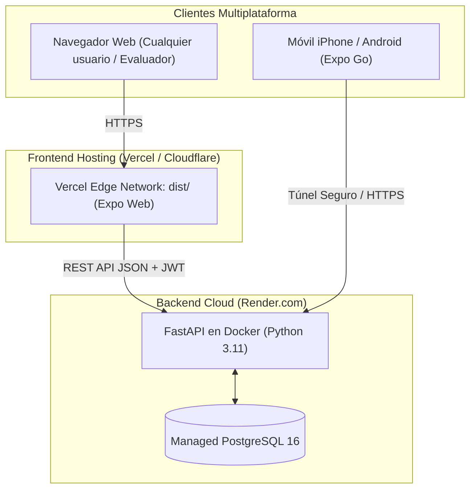

# Guía de Despliegue y Entrega Continua (CI/CD)

Este documento detalla las estrategias de despliegue en producción y el flujo de entrega continua de **Proyecto AI**, dando cumplimiento a los **Criterios 10 (Despliegue) y 11 (CI/CD)** de la rúbrica.

---

## 1. Arquitectura de Despliegue en Producción



### Características de Seguridad en Producción:
- **Aislamiento Multi-usuario:** Cada usuario tiene sus propios recuerdos y tareas privadas (`user_id`).
- **Autenticación Obligatoria:** Los endpoints de datos (`/entries`, `/sync`) requieren token `Bearer JWT`. Peticiones no autorizadas reciben `401 Unauthorized`.
- **Cero exposición de base de datos:** La base de datos PostgreSQL no está abierta a Internet; solo la API tiene acceso interno.

---

## 2. Opción 1: Despliegue en la Nube (Vercel + Render)

El repositorio está preconfigurado como **Infraestructura como Código (IaC)** para desplegarse con un solo clic.

### A. Despliegue del Backend en Render (Gratuito)
1. Inicia sesión en [Render.com](https://render.com/) con tu cuenta de GitHub.
2. Ve a **Blueprints** ➔ **New Blueprint Instance**.
3. Selecciona el repositorio `mariete1223/proyecto-ai`.
4. Render leerá automáticamente el archivo [`render.yaml`](../render.yaml) del repositorio y creará:
   - Una base de datos gestionada **PostgreSQL 16**.
   - El servicio web del backend con [`backend/Dockerfile`](../backend/Dockerfile).
   - Generará una clave secreta segura `SECRET_KEY`.
   - Ejecutará automáticamente las migraciones `alembic upgrade head`.
5. Obtendrás una URL fija pública: `https://proyecto-ai-api.onrender.com`.

### B. Despliegue del Frontend Web en Vercel (Gratuito)
1. Inicia sesión en [Vercel](https://vercel.com/) con tu cuenta de GitHub.
2. Importa el repositorio `mariete1223/proyecto-ai`.
3. Selecciona el subdirectorio **`frontend`** como directorio raíz.
4. Vercel detectará automáticamente el archivo [`frontend/vercel.json`](../frontend/vercel.json) configurado con el comando `npx expo export -p web` y carpeta de salida `dist`.
5. En la sección **Environment Variables**, añade:
   - `EXPO_PUBLIC_BACKEND_URL`: la URL de tu backend en Render (ej. `https://proyecto-ai-api.onrender.com`).
6. Pulsa **Deploy**. Tendrás la app web funcionando públicamente con certificado SSL en `https://proyecto-ai.vercel.app`.

---

## 3. Opción 2: Despliegue en Servidor Propio con Docker Compose

Si prefieres desplegar en un servidor Linux/VPS propio (o en local):

```bash
# 1. Clonar el repositorio
git clone https://github.com/mariete1223/proyecto-ai.git
cd proyecto-ai

# 2. Levantar los 3 contenedores (Base de datos, Backend API y Frontend Nginx)
docker compose up -d --build

# 3. Comprobar que los servicios están activos
docker compose ps
```

- **Frontend:** Accesible en `http://tu-servidor:8081`.
- **Backend API:** Accesible en `http://tu-servidor:8000`.
- **Documentación OpenAPI interactiva:** `http://tu-servidor:8000/docs`.

---

## 4. Opción 3: Despliegue Híbrido con Túnel Seguro Cloudflare

Utilizado habitualmente durante el desarrollo para probar en dispositivos físicos reales (iPhone en redes celulares 4G/5G):

```powershell
.\start.ps1
```
1. Lanza un túnel cifrado temporal de Cloudflare (`https://xxx.trycloudflare.com`).
2. Configura automáticamente la URL en `frontend/.env.local`.
3. Permite a cualquier teléfono móvil con Expo Go conectarse al backend de forma segura sin configurar puertos en el router ni certificados SSL manuales.

---

## 5. Pipeline de Integración y Entrega Continua (CI/CD)

El archivo [`.github/workflows/ci.yml`](../.github/workflows/ci.yml) gestiona todo el ciclo de vida:

1. **Etapa CI (Integración Continua):**
   - Ejecuta en paralelo el job de frontend (ESLint, TypeScript, formateo Prettier y 164 pruebas en Jest).
   - Ejecuta en paralelo el job de backend (Ruff linter, MyPy tipado estricto y 107 pruebas en Pytest).
2. **Etapa CD (Entrega Continua):**
   - Solo se ejecuta si los tests pasan al 100% y el evento es un `push` a la rama principal `main`.
   - Si se configura el secreto `RENDER_DEPLOY_HOOK` en GitHub (Settings ➔ Secrets and variables ➔ Actions), dispara automáticamente la actualización del backend en producción sin intervención humana.
